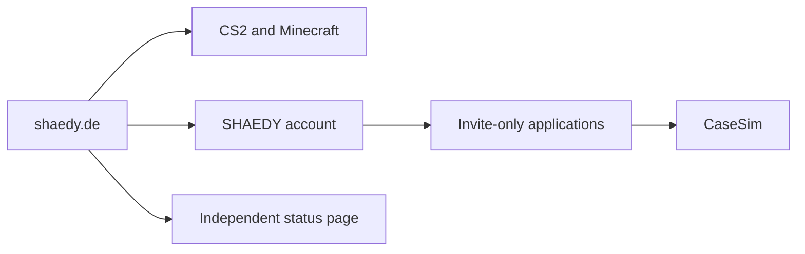

# Hi, I'm shaedy

## About

- Working with TypeScript, Java, Python, C#, and HTML

## Tech

## Featured projects

| Project | What you can find there |
| --- | --- |
| [SHAEDY](https://shaedy.de/) | Community site and entry point for invited members. |
| [CaseSim Desktop](https://github.com/shaedy180/CaseSim-Desktop) | Desktop app for the CS2 case simulator. |
| [CS2 servers and plugins](https://shaedy.de/gameservers) | Server information for invited members and the [public Retakes plugin](https://github.com/shaedy180/cs2-retakes). |
| [Hearth & Horizon](https://shaedy.de/gameservers/hearth-and-horizon) | Minecraft modpack information for invited members. |
| [Atlas](https://github.com/shaedy180/Atlas) | Minecraft recipe and item search. |
| [OBS Now-Playing Overlay](https://github.com/shaedy180/obs-overlay-nowplaying) | Display the current track in an OBS browser source. |

## How the projects connect

## Contact

- [Website](https://shaedy.de/)
- [Ko-fi](https://ko-fi.com/shaedy)
- [Security contact](mailto:security@shaedy.de)
